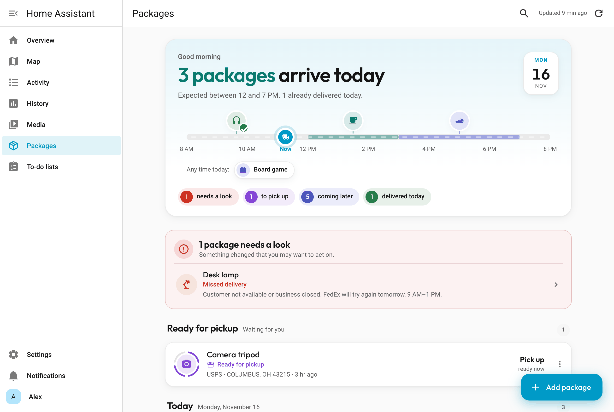
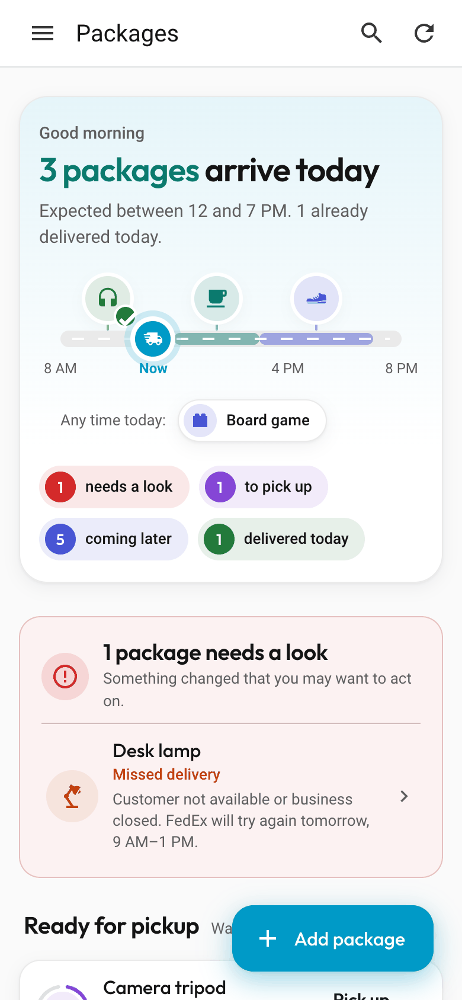
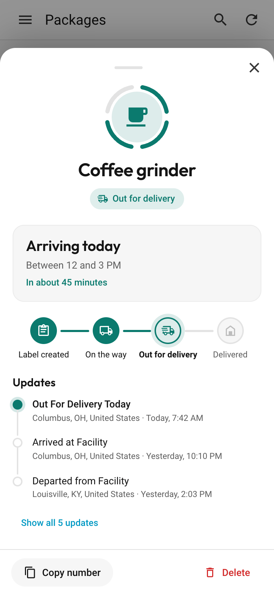
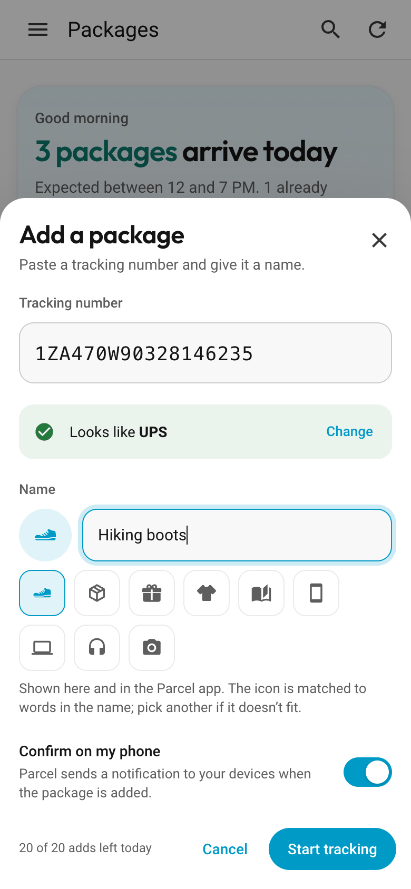

<h1 align="center">
  
</h1>

Follow your [Parcel](https://parcelapp.net) deliveries in Home Assistant. You get a **Packages** sidebar panel to see, add and delete packages, plus sensors, events and automation triggers such as "3 packages are out for delivery" and "Your coffee grinder was delivered".

This is an unofficial integration. It isn't made by or affiliated with Parcel. Its logo was drawn for this project in the style of the Parcel app's icon; it isn't Parcel's own artwork.

<p align="center">
  <picture>
    <source media="(prefers-color-scheme: dark)" srcset="https://raw.githubusercontent.com/kedube/ha-parcel/main/docs/images/panel-dark.png">
    
  </picture>
</p>

## What you get

- **A Packages panel in the sidebar.** It opens with today's deliveries on a timeline, flags anything that needs a look, and groups the rest by when they arrive. You can add a package by pasting its tracking number (the carrier is recognized automatically), and delete packages from the panel too. With the [web sign-in](#let-home-assistant-delete-packages), delivered packages stay in the panel until you delete them, as in the Parcel app.
- **Summary sensors** for automations that don't care about individual tracking numbers: out for delivery, arriving today, needs attention, ready for pickup, on the way, delivered today, and the next delivery time. Each one has a ready-made `message` attribute, such as "3 packages are out for delivery".
- **Triggers in the automation editor** with no YAML needed: *A package was delivered*, *is out for delivery*, *needs attention*, *is ready for pickup*, *was added*, or *any package update*.
- **An event entity** that records every package change, for history and dashboards.
- **A sensor for each package** (optional), removed two days after delivery.
- **Actions** to add, delete and check packages from scripts and automations.
- **Blueprints** for a delivery alert, a morning briefing, and a needs-attention alert.

The panel on a phone: today at a glance, a package's details, and adding a package by its tracking number.

<p align="center">
  
  
  
</p>

## Requirements

- A **Parcel Premium** subscription. Parcel's API comes with it.
- Home Assistant **2026.10** or later.

## Install

**With HACS:** in HACS, open the menu › **Custom repositories**, add `https://github.com/kedube/ha-parcel` as an **Integration**, then install **Parcel** and restart Home Assistant.

**By hand:** download `parcel.zip` from the [latest release](https://github.com/kedube/ha-parcel/releases/latest), unzip it into a new `config/custom_components/parcel` folder in your Home Assistant configuration, and restart.

## Get your Parcel API key

1. Sign in at [web.parcelapp.net](https://web.parcelapp.net) with the same account you use in the Parcel app.
2. Select **API**, next to My Deliveries and Add Delivery.
3. Select **Create a Key**, then **Copy the Key**.

Each Parcel account has one key. If you revoke it and create a new one, Home Assistant shows a notice asking for the new key; your entities and automations stay as they are.

## Set up

1. Go to **Settings › Devices & services › Add integration** and choose **Parcel**.
2. Paste your API key.

The **Packages** panel appears in the sidebar, and a **Parcel** device holds the sensors, event entity and *Check for updates* button. To connect more than one Parcel account (for example, one per person in the household), add the integration again with each account's key. The panel shows them all together.

## Let Home Assistant delete packages

Parcel's API can add and list packages but can't delete them. To delete from Home Assistant, the integration uses your Parcel web sign-in, the same way web.parcelapp.net does. This is optional; everything else works without it.

The sign-in also keeps delivered packages in the panel until they're deleted, as in the Parcel app. Parcel's API stops listing a package about a day after it's delivered. Without the sign-in, the panel can't tell that apart from a delete, so the package goes from the panel then.

1. Sign in at [web.parcelapp.net](https://web.parcelapp.net).
2. Open your browser's developer tools:
   - **Chrome or Edge:** View › Developer › Developer Tools, then the **Application** tab › **Cookies** › `https://web.parcelapp.net`.
   - **Safari:** turn on Settings › Advanced › *Show features for web developers*, then Develop › Show Web Inspector › **Storage** › **Cookies**.
   - **Firefox:** Tools › Browser Tools › Web Developer Tools › **Storage** › **Cookies**.
3. Copy the value of the cookie named **`account_token`**.
4. In Home Assistant, go to **Settings › Devices & services › Parcel › Configure**, paste it into **Parcel web sign-in**, and select **Submit**. Home Assistant checks it before saving.

A saved sign-in is never shown again, so the box is empty the next time you open **Configure**; leave it empty to keep what's saved. When it can tell, Home Assistant also checks that the sign-in belongs to the same Parcel account as the API key. To stop deleting from Home Assistant, turn on **Remove the saved web sign-in**. That makes Home Assistant forget it; to cancel the sign-in itself, sign out at web.parcelapp.net.

The sign-in lasts about a year (Parcel doesn't extend it when it's used). Home Assistant checks it once a day: it shows a repair notice about two weeks before it expires, and right away if it stops working early (for example, after signing out of the web app). Repeat these steps to paste the new one. Treat `account_token` like a password: it gives full access to your Parcel account. Parcel doesn't document these web calls, so a change on Parcel's side could stop deleting from working until this integration is updated.

How delivered packages are kept: when Parcel's API stops listing a delivered package, Home Assistant keeps showing it as the API last listed it. To see which ones are still in your account, it reads the web app's list of your packages right away, and then about once an hour. A package leaves Home Assistant once two reads, at least 10 minutes apart, both find it gone. Then it fires a `removed` event with the reason `deleted`. If you remove the saved sign-in, kept packages leave the panel without any event, because they weren't deleted.

## Automations

### Pick a trigger in the editor

Create an automation, add a **Device** trigger, choose your **Parcel** device, and pick a trigger such as **A package was delivered**. In the action, `{{ trigger.event.data.message }}` gives a sentence like "Coffee grinder was delivered".

### Use a blueprint

Import these from **Settings › Automations & scenes › Blueprints › Import blueprint** by pasting the link:

| Blueprint | What it does | Link to import |
| --- | --- | --- |
| Tell me when a package is delivered | Phone notification for each delivery | `https://github.com/kedube/ha-parcel/blob/main/blueprints/automation/parcel/notify_delivered.yaml` |
| Morning delivery briefing | At a set time: "3 packages arrive today: …" | `https://github.com/kedube/ha-parcel/blob/main/blueprints/automation/parcel/morning_briefing.yaml` |
| Alert when a package needs attention | Missed deliveries and delivery problems | `https://github.com/kedube/ha-parcel/blob/main/blueprints/automation/parcel/needs_attention.yaml` |

### Write your own

Every change fires the `parcel_package_update` event. Its data includes `type` (`added`, `label_created`, `in_transit`, `out_for_delivery`, `ready_for_pickup`, `delivered`, `needs_attention`, `update` or `removed`), `description`, `carrier`, `tracking_number`, `status`, `previous_status`, `event` (the carrier's latest update), `location`, and `message`.

```yaml
# Announce deliveries on a speaker
triggers:
  - trigger: event
    event_type: parcel_package_update
    event_data:
      type: delivered
actions:
  - action: tts.speak
    target:
      entity_id: tts.home_assistant_cloud
    data:
      media_player_entity_id: media_player.kitchen
      message: "{{ trigger.event.data.message }}"
```

```yaml
# Turn on the porch light when something is out for delivery after dark
triggers:
  - trigger: numeric_state
    entity_id: sensor.parcel_out_for_delivery
    above: 0
conditions:
  - condition: sun
    after: sunset
actions:
  - action: light.turn_on
    target:
      entity_id: light.porch
```

## Entities

| Entity | State | Useful attributes |
| --- | --- | --- |
| `sensor.parcel_out_for_delivery` | Number of packages | `message`, `names`, `packages` |
| `sensor.parcel_arriving_today` | Number of packages | `message`, `names`, `packages` |
| `sensor.parcel_needs_attention` | Missed deliveries, problems, no recent updates | `message`, `names`, `packages` |
| `sensor.parcel_ready_for_pickup` | Number of packages | `message`, `names`, `packages` |
| `sensor.parcel_on_the_way` | Packages not yet delivered | `message`, `names`, `packages` |
| `sensor.parcel_delivered_today` | Number of packages | `message`, `names`, `packages` |
| `sensor.parcel_next_delivery_day` | The next day a package is expected | `package`, `names`, `count` |
| `sensor.parcel_next_delivery` | When the next delivery window starts, if a carrier gave a time | `package`, `window_end` |
| `sensor.parcel_<package name>` | The package's status (a package without a name gets `sensor.parcel_<carrier>_package`) | `carrier`, `tracking_number`, `expected`, `last_update`, `last_location` |
| `event.parcel_package_update` | Time of the last change | `event_type`, `message`, `description` |
| `button.parcel_check_for_updates` | Checks Parcel now | |

## Actions

```yaml
# Add a package. The carrier is recognized from the number when you leave it out.
action: parcel.add_package
data:
  tracking_number: "1Z999AA10123456784"
  description: Coffee grinder
  send_push_confirmation: true
```

```yaml
# Delete a package (needs the web sign-in above)
action: parcel.delete_package
data:
  tracking_number: "1Z999AA10123456784"
```

Parcel tracks an Amazon order by shipment, so one order can show up as several packages. To delete one of them with this action, give its number as the order number, `@` and the shipment ID; the event data's `key` ends with it, as in `amzlus:113-4567890-1234567@Ab3Cd9EfG`. Deleting from the panel needs none of this.

```yaml
# Check Parcel now
action: parcel.refresh
```

With more than one Parcel account, add `config_entry_id` to say which one.

Anyone who can sign in to Home Assistant can add, delete and check packages, from the panel or with these actions, except read-only users, who can only look.

## Limits

Parcel allows **20 checks an hour** and **20 new packages a day** through its API, and failed adds count. The integration works within those limits:

- It checks every 10 minutes by default (4 to 60 minutes in **Configure**).
- Manual checks keep a few checks in reserve for the schedule, and the panel shows how many adds are left today.
- After a restart, it reuses the last result if it's recent instead of checking again.
- If Parcel answers "too many requests", the integration pauses its checks for 20 minutes (longer if Parcel asks), keeps showing the last known packages, and says so in the panel. Sensors keep their last values during a pause, and restarting Home Assistant doesn't cut it short.
- If Parcel can't be reached, the last known packages stay on show for about half an hour (three checks, if that is longer) before sensors turn unavailable, so a short outage doesn't set off your automations. The panel says the last check failed.
- If Parcel's reply leaves out a package it listed before, the package stays as it was until it has been missing for 10 minutes, over at least two checks. A reply that briefly lists nothing therefore doesn't announce every package as removed and then new, and doesn't lose their chosen icons. A package really removed in Parcel goes from Home Assistant one check later than it otherwise would.
- With the web sign-in, the integration also reads Parcel's web list of your packages about once an hour, and right after Parcel's API stops listing a delivered package, to see which delivered packages are still in your account. It reads nothing extra while no delivered package is being kept.
- The panel warns you when a tracking number doesn't match the chosen carrier, because Parcel rejects those and the rejected try still counts.

Parcel's API returns Parcel's own cached copy of your deliveries, so changes reach Home Assistant a few minutes after they reach the Parcel app.

## Privacy

Your API key and web sign-in are stored in Home Assistant like other integration credentials. Package details are kept in Home Assistant's `.storage` folder so restarts don't spend checks, and, with the web sign-in, so delivered packages can stay on show after Parcel's API stops listing them. The per-package sensors keep tracking numbers, locations and carrier updates out of Home Assistant's history; the event entity and the `parcel_package_update` event do record them, since automations use them. Home Assistant's entity registry remembers removed sensors for as long as the account is set up. For a package sensor it keeps the entity ID, which comes from the package's name, but never the tracking number; a package without a name gets an entity ID from its carrier instead. Sensors made by earlier versions switch over on their own. Records of sensors removed before the update still hold tracking numbers, until 30 days after the account is removed. The integration talks only to Parcel. Diagnostics downloads remove keys, tokens, tracking numbers, names, locations and the carriers' own update text.

## Troubleshooting

- **"Parcel didn't accept the API key"**: the key was revoked or mistyped. Create a new key in the web app; Home Assistant will ask for it.
- **Packages added in the Parcel app take a few minutes to show up**: that's Parcel's cache; select the refresh button to check sooner.
- **"Parcel asked Home Assistant to slow down"**: Parcel limited requests for a while. Nothing is lost; checks resume on their own at the time shown. If you see this often, raise the check interval in **Configure**, and make sure the same API key isn't used by another Home Assistant or script.
- **Deleting says the sign-in expired**: paste a new `account_token` (see above).
- **Deleting says the sign-in may be for a different account**: the saved `account_token` came from another Parcel account. Sign in at web.parcelapp.net with the account this integration uses and paste its `account_token`.
- **A package deleted in the Parcel app is still in Home Assistant**: if it was delivered more than about a day ago, Home Assistant notices on its next hourly read of Parcel's web list and confirms it a check later, so it can take a little over an hour to go. A package delivered more recently goes two checks after Parcel's API stops listing it.
- **Delivered packages leave the panel after about a day**: that's how long Parcel's API lists them. Add the [web sign-in](#let-home-assistant-delete-packages) to keep them until they're deleted.
- **A new package shows "Waiting for first update"**: Parcel hasn't heard from the carrier yet. It changes on its own.

## Development

- The panel source is in `frontend-src/`. Run `npm ci --ignore-scripts && npm run build` there; the build is written to `custom_components/parcel/frontend/` and committed so HACS installs work.
- The logo and icon are the SVG files in `brand/`. After changing one, run `npm run brand` in `frontend-src/`. It redraws the images Home Assistant and HACS show (`custom_components/parcel/brand/`) and the README banner and social preview (`brand/`); commit those too.
- Python tests, lint and types: `pip install -r requirements-test.txt`, then `pytest`, `ruff check custom_components scripts tests` and `mypy`.
- Panel tests and lint: `npm test` and `npm run lint` in `frontend-src/`. What the panel works out (sections, wording, the day's timeline) is in `src/logic.js`, apart from how it's drawn, so it can be tested without a browser.
- CI runs all of these on every push and pull request.
- Releases are made with the **Release** workflow on GitHub; see [docs/RELEASING.md](docs/RELEASING.md).
- Where each detail about Parcel came from is recorded in [docs/SOURCES.md](docs/SOURCES.md).

## License

[GNU Affero General Public License v3.0](LICENSE), including the logo and icon in `brand/`. The bundled Outfit font is under the SIL Open Font License (`custom_components/parcel/frontend/fonts/OFL.txt`). "Parcel" and the Parcel app's icon belong to Parcel's developer.
